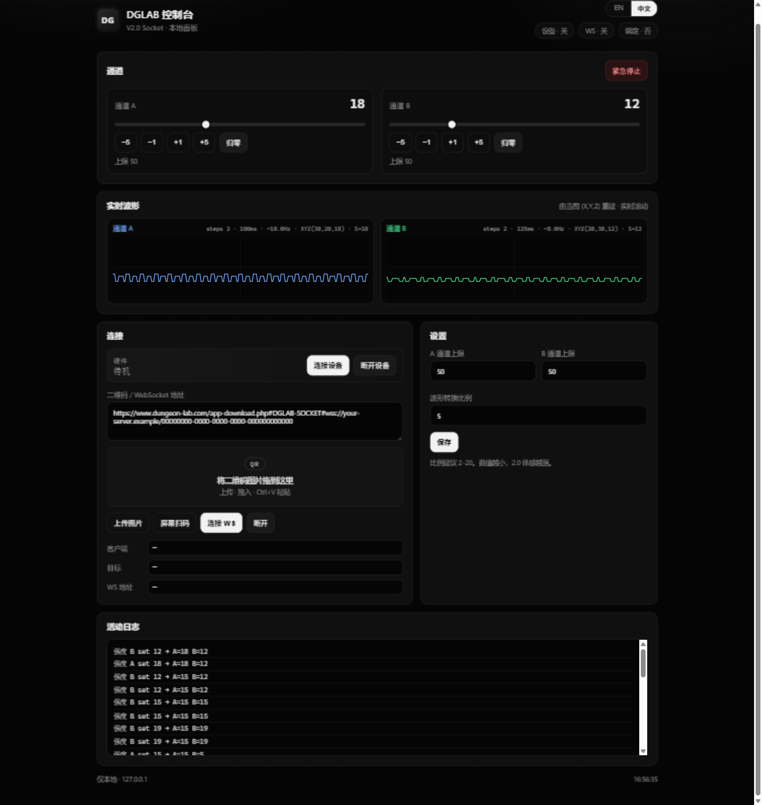

# DGLAB-V2.0-socket

[](https://github.com/a1175815821/DGLAB-V2.0-socket-UI/commits)
[](https://github.com/a1175815821/DGLAB-V2.0-socket-UI/releases)
[](https://github.com/a1175815821/DGLAB-V2.0-socket-UI/stargazers)
[](https://www.python.org/)
[](LICENSE)

<p align="center">
  
</p>

**让 DG-Lab 郊狼 2.0 主机也能用上 3.0 App 的 WebSocket 远控协议。**

跑在本机的 Python 受控端，自带一个浏览器控制面板：手机 App 出二维码 → 面板扫码/粘贴即连，A/B 双通道强度、实时波形示波器、紧急停止，全部在网页里完成。中英双语，无需安装任何 App 插件。

---

## 📖 导航

**只想赶紧用起来？** → [30 秒上手](#-30-秒上手) → [第一次连接](#-第一次连接三步)

**想折腾配置和二次开发？** → [配置](#️-配置-configyaml) → [REST API](#-rest-api) → [波形转换原理](#-波形转换原理)

**遇到问题？** → [常见问题](#-常见问题-faq)

---

## 🚀 30 秒上手

**方式一：下载 Release（推荐）**

1. 从 [Releases](https://github.com/a1175815821/DGLAB-V2.0-socket-UI/releases) 下载最新的 zip 并解压
2. 安装依赖（需要 [Python ≥ 3.10](https://www.python.org/downloads/)）：

   ```bash
   pip install -r requirements.txt
   ```

3. 启动：

   ```bash
   python ./src/main.py
   ```

   Windows 也可以直接**双击 `run.bat`**
4. 浏览器打开 **http://127.0.0.1:8787** 🎉

**方式二：从源码运行**

```bash
git clone https://github.com/a1175815821/DGLAB-V2.0-socket-UI.git
cd DGLAB-V2.0-socket
pip install -r requirements.txt
python ./src/main.py
```

> English quick start: `pip install -r requirements.txt` → `python ./src/main.py` → open http://127.0.0.1:8787 → paste the QR content from the DG-Lab App's SOCKET page. UI is available in English (top-right switch).

## 🔌 第一次连接（三步）

> 前置：手机装好 DG-LAB App（郊狼 3.0），电脑有蓝牙适配器。

1. **手机打开 App 的「SOCKET」页**，会显示一个连接二维码，内容形如
   `https://...#DGLAB-SOCKET#wss://服务器地址/一串UUID`
2. **把二维码交给面板**，四种方式任选：
   - 📋 直接复制二维码内容，粘贴到面板输入框
   - 🖼️ 把二维码**截图拖进**面板的二维码投放区
   - ⌨️ 截图后直接 **Ctrl+V** 粘贴
   - 📱 手机/模拟器画面在电脑屏幕上时，点「屏幕扫码」
3. 点 **「连接 WS」→「连接设备」**，状态指示灯变绿即绑定成功，开始控制

面板和手机 App 可以同时控制，任意一边调整强度都会实时同步。

## 🎛️ 面板功能

| 功能 | 说明 |
|---|---|
| **通道控制** | A/B 强度滑条、±1 / ±5 快捷加减、一键归零 |
| **实时波形** | 基于 (X,Y,Z) 的示波器式实时重建，显示周期、频率、XYZ 参数 |
| **硬件连接** | 面板内直连 / 断开郊狼 2.0 设备（BLE） |
| **WebSocket 连接** | 粘贴 / 拖图 / Ctrl+V / 屏幕扫码，四种方式接入 |
| **紧急停止** | 一键双通道归零 + 复位波形 |
| **设置** | 双通道强度上限、波形转换比例，持久化到 config.yaml |
| **中英切换** | 自动跟随浏览器语言，可手动切换并记忆 |
| **活动日志** | 实时操作记录（带 i18n 翻译） |

## ⚙️ 配置 `config.yaml`

随项目附带，在面板「设置」里点保存后会自动写回这个文件，也可以直接编辑：

| Key | 说明 | 默认值 |
|---|---|---|
| `QR_Content` | 上次使用的二维码内容（含 `wss://`），可留空 | 空 |
| `Channel_A_limit` | 通道 A 强度上限（0–200） | 50 |
| `Channel_B_limit` | 通道 B 强度上限（0–200） | 50 |
| `Wave_convert_ratio` | 3.0 波形 → 2.0 波形的转换比例，建议 2–20 | 5 |
| `Debug` | 调试日志开关 | false |

> 💡 初次使用建议 `Wave_convert_ratio` 从 5 开始：**数值越小，单脉冲越宽，体感越强**，逐步下调找到适合自己的值。

## 📡 REST API

服务只监听 `127.0.0.1`，方便二次开发或接入自动化脚本：

| Method | Path | 说明 |
|--------|------|------|
| GET | /api/status | 全量状态快照 |
| POST | /api/device/connect | 连接设备 (BLE) |
| POST | /api/device/disconnect | 断开设备 |
| POST | /api/strength | 设置强度（`set` / `add` / `sub`） |
| POST | /api/limits | 设置强度上限 |
| POST | /api/wave | 设置波形 |
| POST | /api/emergency-stop | 紧急停止 |
| POST | /api/ws/connect | 连接 WebSocket |
| POST | /api/ws/disconnect | 断开 WebSocket |
| POST | /api/qr/scan | 屏幕扫码 |
| POST | /api/qr/image | 上传图片解码二维码 |
| GET / POST | /api/config | 读取 / 更新配置 |

## 📐 波形转换原理

郊狼 2.0 与 3.0 的波形存储方式不同：3.0 协议里是十六进制波形串，本项目负责把它转换成 2.0 的 `(X, Y, Z)` 三元组：

- **X** = 脉冲时间 (ms) = `1000 / freq / ratio`
- **Y** = 间隔时间 (ms) = `1000 / freq - X`
- **Z** = 强度系数 = `strength / 5`

`Wave_convert_ratio`（建议 2–20）数值越小体感越强。面板顶部的示波器就是按这套参数实时重建的。

## 🧭 项目结构

```
DGLAB-V2.0-socket/
├── src/
│   ├── main.py          # 入口
│   ├── api.py           # FastAPI 服务 (REST API)
│   ├── device.py        # BLE 设备管理
│   ├── ws_client.py     # WebSocket 客户端
│   ├── handler.py       # WS 协议消息处理
│   ├── model.py         # 状态模型 (AppState)
│   └── utils.py         # 二维码 / 波形转换
├── web/
│   ├── index.html       # 面板 HTML
│   ├── style.css        # 样式
│   ├── app.js           # 面板交互逻辑
│   ├── wave.js          # 实时波形可视化
│   ├── i18n.js          # 国际化运行时
│   └── i18n/            # 翻译文件 (en / zh)
├── docs/                # 截图等文档资源
├── config.yaml          # 本地配置（不入库，从 example 复制）
├── config.example.yaml  # 配置模板
├── requirements.txt     # Python 依赖
└── run.bat              # Windows 启动脚本
```

### 添加新语言

1. 在 `web/i18n/` 下新建 `xx.json`（复制 `en.json` 翻译）
2. 在 `web/i18n/index.json` 的 `locales` 数组中添加条目
3. 在 `web/index.html` 中补充 `<button data-locale="xx">`

## ❓ 常见问题 (FAQ)

<details>
<summary><b>点「连接设备」失败 / 找不到设备？</b></summary>

- 确认电脑蓝牙可用，且郊狼主机已开机
- Windows 需要在系统蓝牙设置里允许应用访问蓝牙
- 如果失败后重试一直卡住，先点「断开设备」再重连
</details>

<details>
<summary><b>二维码扫不出来 / 解码失败？</b></summary>

- 屏幕扫码只识别<strong>电脑屏幕</strong>上的二维码；手机上的二维码请截图后拖入面板
- 图片尽量裁掉多余边缘，避免反光和摩尔纹
- 也可以直接复制二维码内容的文本粘贴进输入框
</details>

<details>
<summary><b>安装依赖时 pyzbar 报错？</b></summary>

- Windows：`pyzbar` 的 wheel 自带运行库，一般直接可用；如报 DLL 错误，安装 [Visual C++ Redistributable](https://aka.ms/vs/17/release/vc_redist.x64.exe)
- Linux（Debian/Ubuntu）：`sudo apt install libzbar0`
- macOS：`brew install zbar`
</details>

<details>
<summary><b>需要什么版本的 Python？</b></summary>

**3.10 及以上**（代码使用了 PEP 604 类型语法）。
</details>

<details>
<summary><b>面板能被局域网里其他设备访问吗？</b></summary>

默认**不能**——服务只监听 `127.0.0.1`，这是有意为之的安全设计。面板没有鉴权，<strong>请不要</strong>通过修改代码暴露到公网。
</details>

## ⚠️ 安全与免责

- 请**从零强度开始**，循序渐进；设置里可限制双通道强度上限（0–200）
- 本项目仅供已成年且自愿者之间知情使用，使用者需自行承担全部风险
- 面板随时可以点「紧急停止」双通道归零

## 🙏 致谢与支持

- 基于 [DGLAB-python-driver](https://github.com/shilapi/DGLAB-python-driver)（BLE 驱动层）
- 协议参考：[DG-LAB SOCKET 开源文档](https://github.com/ZGQ-inc/DG-LAB-OPENSOURCE/blob/main/socket/README.md)

如果这个项目帮到了你，欢迎点一个 ⭐ Star——这是给开源作者最直接的动力，也让更多郊狼 2.0 用户能看到它。PR / Issue 同样欢迎！

<a href="https://star-history.com/#a1175815821/DGLAB-V2.0-socket-UI&Date">
 <picture>
   <source media="(prefers-color-scheme: dark)" srcset="https://api.star-history.com/svg?repos=a1175815821/DGLAB-V2.0-socket-UI&type=Date&theme=dark" />
   <source media="(prefers-color-scheme: light)" srcset="https://api.star-history.com/svg?repos=a1175815821/DGLAB-V2.0-socket-UI&type=Date" />
   
 </picture>
</a>
